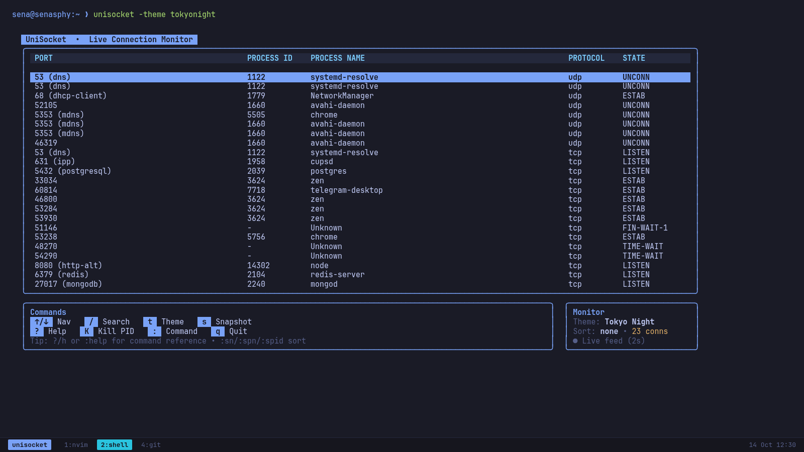
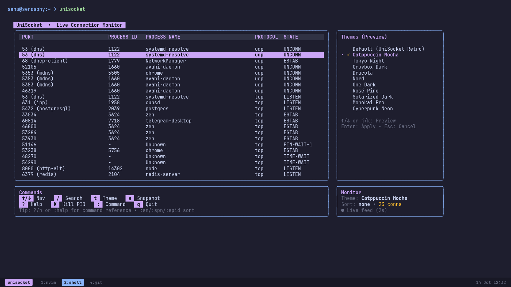

# UniSocket

UniSocket is a cross-platform terminal dashboard for live network connection monitoring.  
It is built with Go + Bubble Tea, and designed with a polished retro terminal look while staying keyboard-first.

## Screenshots




## Features

- Live refresh of active connections.
- Process-aware rows: port, PID, process name, protocol, and state.
- Cross-platform engines (Linux, macOS, Windows).
- Keyboard-first workflow with search, sorting, snapshot export, and process termination.
- Retro visual style with strong selected-row focus for fast scanning.

## Installation

### 1. Scripted Install (Unix / Windows)

For a one-command install, you can run the installer scripts directly from this repository.

Unix (Linux/macOS):

```bash
curl -fsSL https://raw.githubusercontent.com/Senasphy/unisocket/main/scripts/install.sh | sh
```

Windows PowerShell:

```powershell
iwr -useb https://raw.githubusercontent.com/Senasphy/unisocket/main/scripts/install.ps1 | iex
```

### 2. Install From GitHub Releases

1. Open the latest release page: `https://github.com/Senasphy/unisocket/releases/latest`
2. Download the archive for your OS/architecture.
3. Extract it and move the binary to a directory in your `PATH`.

Linux/macOS example:

```bash
chmod +x unisocket
sudo mv unisocket /usr/local/bin/unisocket
```


### 3. Install With Go

```bash
go install github.com/Senasphy/unisocket/cmd/unisocket@latest
```

### 4. Build From Source

```bash
git clone https://github.com/Senasphy/unisocket.git
cd unisocket
go mod tidy
go build -o unisocket ./cmd/unisocket
```

## Usage

```bash
unisocket
```

### Startup Flags

- `-tcp`: Show TCP only.
- `-udp`: Show UDP only.
- `-estab`: Show established connections only.
- `-lsg`: Show listening connections only.
- `-find <name>`: Filter by process/service name at startup.
- `-theme <name>`: Launch with a specific theme (e.g., `catppuccin`, `tokyonight`, `gruvbox`).
- `-config <path>`: Path to a custom configuration file.
- `-print-config`: Print the active configuration JSON and exit.

## Configuration

UniSocket automatically creates and loads a configuration file from:
- **Linux/macOS**: `~/.config/unisocket/config.json`
- **Windows**: `%APPDATA%\unisocket\config.json`

You can customize themes, refresh intervals, startup filters, default sort modes, and even define your own custom color palettes:

```json
{
  "theme": "tokyonight",
  "refresh_interval": 2,
  "default_sort": "process-name",
  "snapshot_filename": "portList.json",
  "filters": {
    "tcp": false,
    "udp": false,
    "established": false,
    "listening": false,
    "find_by_name": ""
  },
  "custom_themes": [
    {
      "id": "matrix",
      "name": "The Matrix",
      "description": "Green phosphor retro terminal glow",
      "text": "#00ff66",
      "muted": "#005522",
      "border": "#00ff66",
      "highlight": "#003311",
      "title_text": "#00ff66",
      "status": "#00ff88",
      "header_bg": "#002211",
      "header_fg": "#00ff66",
      "header_border": "#00ff66",
      "selected_bg": "#00ff66",
      "selected_fg": "#001100",
      "modal_border": "#00ff66"
    }
  ]
}
```

Any custom theme added to `custom_themes` is immediately registered and selectable via the interactive picker (`t`), command row (`:theme matrix`), or `-theme matrix` flag.

## Navigation & Controls

- `↑/↓` or `j/k`: Move selection.
- `t`: Open Theme Switcher with live preview (side-by-side on wide screens, stacked on compact screens).
- `?` or `h`: Open Help & Command Reference dialog.
- `/`: Open search row (live filtering while typing).
  - `Esc` or `Ctrl+C`: Exit search mode and clear filter without quitting.
  - `Enter`: Confirm filter and return to table.
  - `Tab` or `↓`: Keep current search filter and move focus back to table.
- `:`: Open command row (Neovim-style).
  - `Esc` or `Ctrl+C`: Cancel command mode.
- `s`: Save current table to JSON snapshot.
- `K`: Open process termination confirmation popup.
- `Esc`: Clear active search filter (when on table), or cancel dialog.
- `q`, `ctrl+c`: Quit.

### Command Row

- `:help` or `:h` open help and command reference dialog.
- `:sn` sort by connection/service name (PORT column).
- `:spn` sort by process name.
- `:spid` sort by PID.
- `:theme` or `:t` open theme switcher modal.
- `:theme <name>` or `:t <name>` switch theme directly (e.g., `:theme catppuccin`, `:theme tokyonight`, `:t gruv`).
- `:q` or `:quit` quit UniSocket.

## Themes

UniSocket includes 11 themes with persistent preference storage:

- `default` - Classic UniSocket retro cyan & amber
- `catppuccin` (or `mocha`) - Catppuccin Mocha soothing pastel dark
- `tokyonight` (or `tokyo`) - Tokyo Night neon downtown lights
- `gruvbox` (or `gruv`) - Gruvbox Dark warm earthy groove
- `dracula` - Dracula vibrant gothic dark theme
- `nord` - Nord clean arctic blue palette
- `onedark` - One Dark balanced Atom/Neovim palette
- `rose-pine` (or `rose`) - Rosé Pine cozy Soho aesthetic
- `solarized-dark` (or `solarized`) - Solarized Dark low-contrast classic
- `monokai` - Monokai Pro high-contrast vibrancy
- `cyberpunk` (or `synthwave`) - Cyberpunk Neon synthwave glow

## Process Termination

Press `K` on a selected row to open a confirmation popup.

- `Enter`: Confirm termination.
- Any other key: Cancel.

## Snapshots

Snapshots are exported as formatted JSON and include:

- timestamp
- port
- process-id
- process-name
- protocol
- state


## Contributing

Contributions are welcome from anyone.

- Open an issue for bugs or feature requests.
- Open a pull request with clear scope and rationale.
- Keep changes focused and tested (`go test ./...`).

## License

Licensed under the MIT License. See [LICENSE](./LICENSE).
